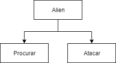
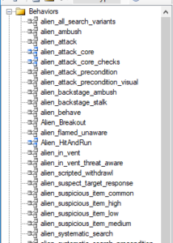

import AdSlot from '@/components/AdSlot.astro';

_Alien_, o Oitavo Passageiro é um clássico filme de terror e ficção científica lançado em 1979. Na esteira de sucesso do filme surgiu uma franquia de livros, brinquedos e jogos.
**Alien Isolation** é uma tentativa bem-sucedida de adaptação deste clássico para o mundo dos games. O fluxo de tensão nesse _survival horror sci-fi_ consegue transportar o jogador para o universo opressivo, criado por Ridley Scott.
Neste artigo analisamos a estrutura desenvolvida para criar a inteligência artificial por trás do organismo perfeito, também conhecido como **Alien** ou **Xenomorfo**.

---

## Objetivo

Atualmente, os sistemas de inteligência artificial existentes são criados para desempenhar uma tarefa específica. O programa [Deep Blue](https://pt.wikipedia.org/wiki/Deep_Blue), por exemplo, só é inteligente para jogar xadrez.

> Como estamos razoavelmente longe de criar um sistema generalista (IA forte), ainda não precisamos nos preocupar com a Skynet.

Um fluxo variável de tensão é muito importante para manter o interesse no jogo. Quer dizer, a tensão não pode ser constante: se o jogo for muito tenso pode ser que o jogador desista, e se não houver tensão suficiente, ele perde o interesse. Falamos disso com mais detalhes no artigo sobre o [Círculo Mágico](https://gamefoss.com.br/ludokratia/dentro-do-circulo-magico/).

No caso de _Isolation_ a tensão está relacionada à proximidade do jogador com o Alien. Por se tratar de um inimigo que caça o tempo todo e pode matar com um único golpe, quanto mais perto ele estiver, maior será o nível de tensão.

<AdSlot format="article" />

## As Duas Inteligências

Para atingir um bom fluxo de tensão, o jogo utiliza dois sistemas de IA com comportamentos distintos: a Macro IA, que avalia o sistema e coordena o nível de tensão (**IA Diretora**) e a Micro IA, que se estrutura com base em um sistema modular que determina as ações (**IA do Xenomorfo**).

### IA Diretora

Como é a proximidade com o _Alien_ que comanda a tensão no jogo, o sistema é capaz de “trapacear”. Uma vez que a presença da criatura só é fixa em poucos pontos (por conta de _cutscenes_ e afins), é função da **IA Diretora** analisar o jogo a todo o momento para garantir o equilíbrio da tensão, aproximando ou afastando o _Alien_ do jogador. A **IA Diretora** sempre sabe onde está o jogador e qual é o seu estado, embora não compartilhe essa informação com a **IA do Xenomorfo**.

A **IA Diretora** é responsável pelo que podemos chamar de medidor de ameaça, um sistema que coordena o nível de tensão. Isso é feito por medições de certas variáveis:

- Proximidade entre o jogador e o **Xenomorfo**
- Tempo perto do jogador
- Tempo sendo visto pelo jogador
- Tempo visível no sensor de movimento e perto o suficiente para atacar

Esse último é importante, pois o Alien pode estar no sensor de movimento, mas em outra sala, por exemplo, o que diminuiria o nível de ameaça.

> O princípio norteador é: Quanto mais perto do Alien, mais assustador fica o jogo.

Além de analisar esses fatores e aproximar ou afastar a criatura, dependendo do nível de **ameaça**, a **IA Diretora** controla as ações do Alien por meio de um sistema de trabalho, que decide as tarefas que ele deve executar, onde devem ser realizadas e quais as prioridades. Essas tarefas podem variar desde a forma de procurar o jogador em determinada localização até tocar uma animação específica. Esse sistema faz com que o Alien opere em dois estados: **Ativo** e **Passivo**.
No estado **Ativo**, o _Alien_ está caçando, o que aumenta o nível do medidor de ameaça. No estado **Passivo**, o _Alien_ está escondido ou se afastando do jogador, com o propósito de reduzir o nível de tensão.

### IA do Xenomorfo

O Xenomorfo tem seu próprio sistema de IA, que o ajuda na localização do jogador.

### Comportamento

A **IA do _Alien_** é composta por um sistema de **Árvore do Comportamento** (_Behavior Tree_), que se subdivide para cada comportamento específico.

> A **Árvore do Comportamento** é um modelo matemático modular usado em ciência da computação para descrever um plano de execução de tarefas. Desse modo é possível dividir uma tarefa complexa (criar um _Alien_) em várias tarefas menores (atacar, procurar, fugir etc.).
>
> Cada uma dessas subdivisões é chamada de Nó (Node), que podem continuar sua ramificação para execução de tarefas ainda mais específicas.
>
> 
>
> exemplificação

A árvore do comportamento do Alien é composta por mais de uma centena de nós. O nível mais alto de decisão deste sistema, ou seja, a parte da árvore responsável por escolher qual dos subsistemas vai atuar para executar determinada tarefa tem sozinho em torno de 30 nós.

Algumas das árvores de comportamento do Alien

Para tornar o jogo mais interessante, parte desta árvore é bloqueada no começo e os diferentes nós vão sendo desbloqueados quando determinadas condições são atingidas durante o gameplay. Isso garante variabilidade ao comportamento apresentado pelo Alien no decorrer do tempo.

### Sensores

O _Alien_ possui vários sensores capazes de detectar sons – desde disparos até pegadas. Esses sensores “dizem” ao Alien onde procurar e dão a ele a capacidade de responder aos estímulos do ambiente.
Os desenvolvedores podem especificar locais onde o Alien não irá de jeito nenhum, tornando seguro fazer barulhos ali.
Ele não possui sensores para saber se alguém pisou em seu rabo, mas possui um sensor de proximidade bastante aguçado, sendo difícil alguém executar essa façanha.

<AdSlot format="article" />

### Busca

O _Alien_ possui um sistema de busca. Quando a **IA Diretora** o encaminha para um ambiente, existe uma série de locais que devem ser vasculhados. Esses pontos de interesse podem ser definidos pelos desenvolvedores ou criados dinamicamente pela ação do jogador.
O Alien se movimenta de modo a cobrir todos os pontos de interesse, porém ele não faz isso de maneira otimizada e pode passar pelo mesmo local mais de uma vez.

---

Alien Isolation inova ao utilizar um antagonista completamente controlado por um sistema de IA dentro de um gênero de horror e é exatamente isso que carrega toda a força do título. Com certeza o jogo não seria tão interessante sem essa imprevisibilidade permitida pela IA.

---

**Alien Isolation** está disponível para [PC](https://store.steampowered.com/app/214490/Alien_Isolation/), [XBOX](https://www.microsoft.com/pt-br/p/alien-isolation/c1h9v6slk2k5) e [Playstation 4](https://store.steampowered.com/app/214490/Alien_Isolation/).

---

## Referências:

[The AI of Alien: Isolation | AI and Games](https://www.youtube.com/watch?v=Nt1XmiDwxhY)

[Behavior trees](https://en.wikipedia.org/wiki/Behavior_tree_\(artificial_intelligence,_robotics_and_control\))
