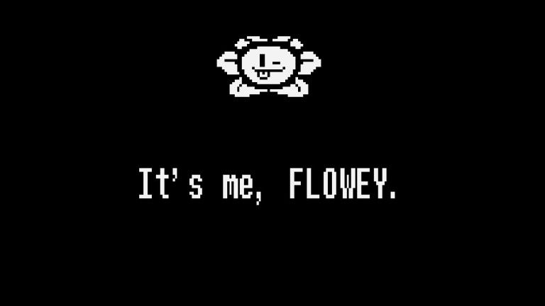
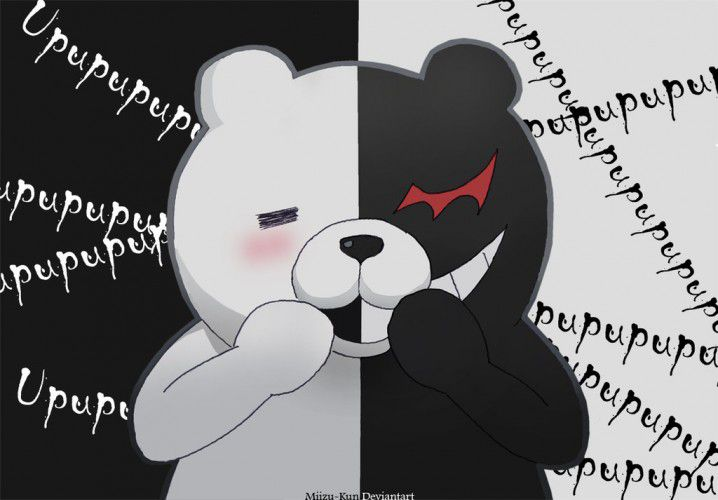
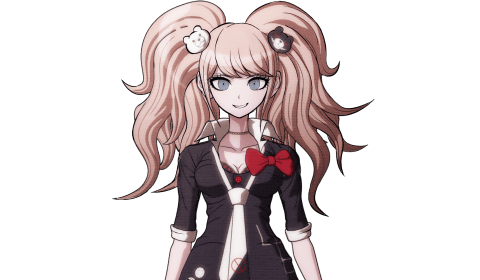
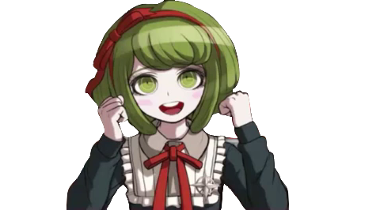
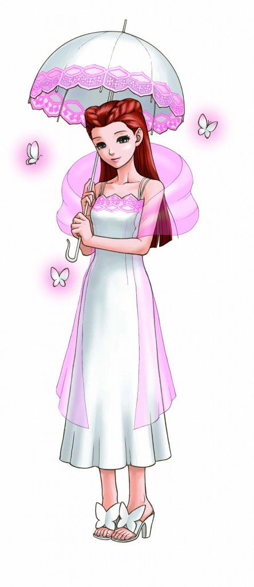

No último texto, falamos sobre como é importante definir os objetivos e vontades do protagonista e fazer o jogador se relacionar com eles. Também sobre como o modelo “mocinho x vilão” está saturado e precisa de uma renovada no universo do entretenimento de maneira geral, não só nos games. Mas isso não quer dizer que vilões não podem ser usados, mas apenas precisam ser **melhor pensados**. Escrevendo a última publicação, pensei em alguns exemplos que funcionaram muito bem em seus cenários e, por isso, trouxeram não só um enriquecimento para o enredo, mas tornaram os vilões personagens **relacionáveis.** Por isso, irei citá-los e farei alguma reflexões acerca deles.

> Inclusive, já deixo o aviso de spoilers. Irei analisar os acontecimentos a fundo, então irei trazer sim coisas que só quem jogou vai conhecer. Quem quer jogar e viver essas personagens antes, por favor, pare de ler por aqui.

---

## Flowey

Flowey é um dos termômetros morais de Undertale, porque, assim como Sans, representa um extremo, uma ideia. Você escolhe se fica do lado dele ou não e, por isso, faz parte do sistema de decisões que compõem esse jogo. Mas aqui temos um antagonista que trabalha e se comporta como tal, mas que não faz parte da motivação central do jogador. Na verdade, em duas das três rotas principais do jogo você mal o vê. Ele te segue o tempo inteiro, te vigia de perto, é citado uma vez ou outra mas não aparece para o protagonista até o fim do jogo, quando ele se torna o chefão final. Só na rota genocida, quando o jogador e o antagonista tem o mesmo objetivo, que há alguma interação, algumas conversas para mostrar a aproximação das personagens.

O melhor da personagem, no entanto, é o fato de que, quanto mais você descobre sobre a história de Flowey, melhor ele fica. A florzinha dourada era, na verdade, o filho de Asgore, Asriel Dreemur, e ele esteve bastante relacionado com a queda do Primeiro Humano, Chara, já que durante um tempo ambos foram criados como irmãos. Chara, no entanto, tinha um comportamento um pouco sádico e odiava os humanos acima de tudo. Por isso que, para se vingar deles, Asriel foi coagido a participar do plano que aquelx humanx bolou, ajudando-x a se matar, absorvendo sua alma para atravessar a barreira e levando o corpo dx amigx de volta para a vila de one elx veio. O plano só falhou porque Asriel não matou os humanos, mas acabou sendo morto por eles e, através do experimento feito por Alphys, foi ressuscitado na forma de uma flor usando “determinação”, a substância que mantém os humanos vivos até quando estão à beira da morte. O problema é que ele não tinha mais sua alma e, sem ela, Flowey se tornou uma criatura sem sentimentos, sem remorso. Alguém frio e violento pela simples frustração de ter perdido a capacidade de sentir amor, remorso ou qualquer outra coisa.

Dessa forma, fica claro que aqui temos um antagonista que pode ser visto como vítima.  Asriel está sofrendo pelas coisas que aconteceram com ele, então também há uma jornada que a personagem faz para se vingar do que fizeram com ele, de destruir o mundo para poder resetá-lo. Isso dá profundidade para ele, tornando-o um vilão de enredo muito bom e que integra de maneira muito sólida o universo do jogo.

---

## World Ender

A franquia Dangan Ronpa tem personagens no mínimo, estranhos. Desde o primeiro jogo o exagero e a caricatura fizeram parte da construção dos 15 protagonistas – jogáveis ou não – que participam do _Killing Game_ em Hope’s Peak Academy. Entretanto, existem figuras centrais que comandam as motivações do jogador, especialmente no final de cada jogo: Monokuma, Junko Enoshima, Monaca e, indiretamente, Mukuro Ikusaba.

Monokuma é basicamente o “mascote” da franquia, e o antagonista que mais se revela para o jogador. O urso preto e branco no seu design já mostra sua premissa de “metade esperança, metade desespero” e tem características bastante distintas: sádico, sarcástico mas, acima de tudo, coerente. Ele pode ter sequestrado 15 jovens, feito eles se matarem, mas ele nunca quebra as regras que ele mesmo coloca. Ele não volta atrás, trai ou se contradiz. Monokuma sempre se comporta como o mediador do _Killing Game_, só aparecendo para  servir de alívio cômico ou fazer uma provocação para o grupo, na forma dos “motivos” que ele coloca para provocar os alunos a se matarem ou em diálogos em que coloca para eles o paradigma da vontade de sair dali versus o preço que eles pagariam por isso. Esse é um antagonista que literalmente vive para manipular os personagens, foi criado para isso e que não se sabe muito dele, só que alguém o está controlando à distância.

Junko Enoshima

Esse alguém é _Junko Enoshima_, apresenta no início do primeiro jogo como a _Ultimate Fashionista_ e que de primeira é só mais uma personagem que está tão desesperada para sair daquele cárcere quanto os outros. Entretanto, depois que o primeiro assassinato acontece, Junko confronta Monokuma por se recusar a participar dos Tribunais de Classe, afinal, ela não queria “tomar parte na morte de ninguém”, já que a conclusão de qualquer Tribunal é com a execução do assassino, se este for pego, ou de todos os outros, se a acusação cair na pessoa errada. Esse confronto termina com Junko agredindo Monokuma, violando uma das regras mais importantes, e acaba sendo punida pelo pequeno urso com a morte. Ou foi assim que pareceu.

No final do jogo, o último caso trata da morte da 16ª estudante, Mukuro Ikusaba, e o que se revela é que ela na verdade era irmã de Junko e que estava personificando a _Ultimate Fashionista_ enquanto a mesma controlava Monokuma por detrás da cena. Juntas, elas eram as _Ultimate Despair Sisters_, e estavam querendo provocar _desespero_ nos estudantes, escondendo o máximo possível do mundo exterior, enquanto os colocava em uma situação aparentemente sem saída, tirando completamente o controle deles da própria vida.

O plano das irmãs era: manipular a memória deles, tirando qualquer lembrança dos últimos dois anos e da vida dos alunos em _Hope’s Peak Academy_, fazendo-os esquecer inclusive porque eles estavam ali, e, principalmente o que no jogo é chamado de _O Evento Mais Terrível e Trágico da História da Humanidade_. Dessa forma, não só todos não sabiam como foram parar ali, mas que eles próprios se trancaram lá dentro para, além de se proteger dos eventos no _mundo exterior_ pós-tragédia, como também para servir como _esperança_ e elaborar uma resposta para reverter os danos que o mundo inteiro estava sofrendo.

O que de mais genial as irmãs fizeram foi transformar o refúgio dos jovens num cárcere. Trazendo a _Vida Escolar de Assassinatos_, e tirando a memória deles, aquilo não era mais um ambiente seguro, mas uma prisão, um sequestro. E ainda por cima, tudo o que acontecia dentro da escola estava sendo transmitido, transformando também a _esperança_ que os alunos deveriam representar em _desespero._ Porque, se até os jovens que deveriam salvar a todos estão se matando entre eles, o que resta no mundo para se acreditar? Tudo estava muito bem elaborado, e por trás disso ainda havia o _World Ender_, que tinha como objetivo destruir o mundo como ele era conhecido. Criar um mundo completamente novo e cheio de _desespero._

A _World Ender_ ainda tinha mais uma cabeça por trás dele. Alguém que havia sido inspirada por _Junko_ e acabou se tornando uma líder e um ser com muito mais potencial para o _desespero_ que qualquer outro: Monaca. Quem vê a criancinha na cadeira de rodas não sabe que seu maior objetivo é, antes de mais nada, matar todos os adultos do mundo, junto com os _Warriors of Hope_, grupo que ela lidera. Ela é a verdadeira criadora do Monokuma e boa parte do que se conhece como “_O Evento Mais Terrível e Trágico da Humanidade_” é responsabilidade dela.

Isso porque Monaca usou da influência que ela conquistou na empresa de sua família, o Grupo Towa, para convencer a produzir os Capacetes de Monokuma e os Monokumas, que estão amplamente presentes no terceiro jogo como ferramenta de lavagem cerebral nas crianças e assassinato dos adultos. Como uma criança que teve que viver com o fato de que seus pais não queriam que ela tivesse nascido e com fortes evidências de que ela sofria abusos físicos e sexuais, Monaca criou um ódio especial pelos adultos e reuniu seu grupo de crianças chamado _Warriors of Hope_, cuja a primeira missão era nada menos que um suicídio coletivo. Monaca não planejava se matar, mas estava testando sua influência sobre seus companheiros. Foi nessa época em que ela conheceu Junko Enoshima e nela finalmente encontrou alguém com quem ela se identificava.Juntas, elas iniciaram o plano de exterminar os adultos e dominar o mundo com desespero.

Depois da morte de Junko, Monaca começa procurar uma sucessora, encontrando em Komaru Naegi (protagonista do terceiro jogo) um potencial enorme. Ela, seguindo o exemplo de sua mentora, a manipulou por uma série de “jogos demoníacos” para tentar fazê-la ser dominada pelo desespero e trazê-la como a segunda Junko Enoshima. A ideia era no final dos jogos, ela deixar Komaru pegar o controle dos capacetes de Monokuma e deixá-la com a decisão de ou desativas os capacetes ao custo da vida de todas as crianças da cidade ou não desativar e provocar a ira dos adultos, que clamavam pelo fim daquele pesadelo a qualquer custo. Com esse poder de manipulação e a inteligência até na maneira de se relacionar com as pessoas provavelmente faz Monaca ser de fato uma das melhores vilãs que eu já vi em um videogame.

---

## Dahlia Hawthorne

Dahlia é completamente diferente dos exemplos que eu dei acima. Especialmente porque ela primeiro _se torna_ uma vilã de uma maneira inesperada. Claro que a série _Ace Attorney_ é conhecida também por personagens se revelarem criminosos/vilões durante os casos, mas com essa personagem é mais bem trabalho, porque até a paleta de cores “flor de pêssego” que ela tem trabalha para você nunca suspeitar dela. E, diferente de todos os outros jogos, ela é _central_, dos 5 casos do jogo, 3 envolvem ela e sua história com Mia Fey e com o próprio Phoenix.

Sua história também é mais bem desenvolvida: foi uma testemunha no primeiro caso que Mia trabalhou, e acabou se revelando a principal culpada. Com apenas 14 anos, armou com seu namorado seu próprio sequestro para roubar um diamante de 1 milhão de dólares que seu pai tinha. Quando o plano dá errado, ela pega o diamante e se joga da ponte aonde a negociação estava acontecendo, deixando o namorado para receber toda a culpa pelo seu sequestro e assassinato. Anos depois, quando ele está no corredor da morte, e acusado de fugir da prisão e de matar a ex-cunhada, Dahlia aparece com outro nome só para testemunhar contra ele e é pega na mentira por Mia Fey, só não acabando atrás das grades graças a seu namorado, que comete suicídio tomando o veneno que ela mesma deu a ele caso “eles não conseguissem confiar mais um no outro.”. Esse veneno estava escondido numa garrafinha de um colar que servia como uma espécie de “aliança de compromisso” entre eles

Nessa mesma época, Diego Armando, namorado da Mia Fey, começou a fazer sua própria investigação sobre esse caso, mas também foi envenenado por Dahlia usando o mesmo veneno usado no suicídio e escondido na mesma garrafinha do mesmo colar que seu namorado usou. Durante sua fuga, Dahlia encontrou Phoenix, e entregou o colar para ele como se fosse um presente, fingindo ser uma mulher interessada nele e até se tornando namorada dele durante um bom tempo, para manter esse teatro todo.

O único problema nesse plano é que, mesmo pedindo pelo colar de volta, Phoenix não devolvia, porque tinha um apego pelo presente, e ainda mostrava para todo mundo que aquele colar era “uma prova de amor entre os dois”. Isso a deixou com uma única decisão para recuperar aquilo que era a prova conclusiva de dois crimes que havia cometido: matar Phoenix. Novamente, esse plano dá errado, já que ela é pega por um ex-namorado roubando veneno do laboratório de química da faculdade dele e ela acaba tendo que matá-lo e o que lhe resta é tentar colocar a culpa em Phoenix. Nem isso dá certo, já que Mia decide defender Phoenix e finalmente consegue provar que ela não só matou a vítima desse caso, como dos dois anteriores.

Depois de tudo isso, ela é condenada à morte, mas mesmo depois de morta, Dahlia fazia parte dos planos de Morgan Fey, sua mãe, que quer matar Maya Fey para assumir seu lugar no Clã Fey. Esse plano quase tem sucesso, mas a interferência de Mia Fey e Misty Fey – irmã mais velha e mãe de Maya, respectivamente -acaba fazendo ela ficar presa no corpo da Maya, lugar do qual eventualmente acaba sendo expulsa.

Dahila Hawthorne é o tipo de vilã que é perserverante, mas nunca consegue de fato cumprir suas ambições. Isso porque é bloqueada por Mia Fey, que a descobre e a impede sempre. O mais interessante é que Mia rouba todo o protagonismo nesse cenário, mesmo que o Personagem Jogável seja Phoenix Wright muitas vezes. Isso porque uma ordem foi estabelecida: enquanto Mia puder interferir, Dahlia nunca vai conseguir vencer.

---

Esses vilões se estabelecem de maneiras diferentes, por motivos diferentes, mas sempre cumprem muito bem seu papel. Um bom vilão não segue regras, mas _princípios_, como ter uma motivação bem estabelecida, causam alguma espécie de empatia com o jogador e, principalmente: contribuem com a motivação do protagonista. Dessa forma, um vilão pode ser uma receita já saturada nas mídias, mas um bom vilão pode sim compensar por isso. É só usá-lo de forma que faz sentido e que se encaixa com o enredo.
