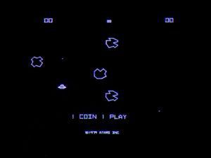
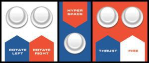
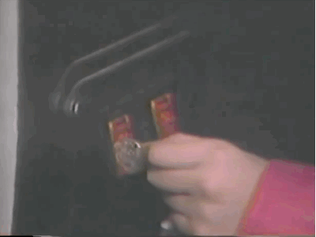
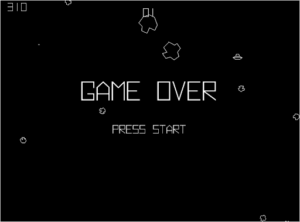
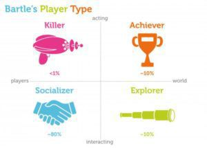
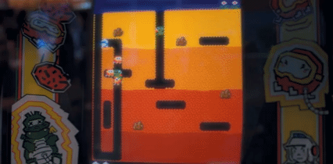
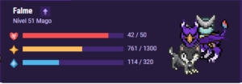

## O que é Asteroids ?

**Asteroids** é um jogo produzido pela **Atari** em 1979, desenvolvido por [_Lyle Rainse_](https://en.wikipedia.org/wiki/Lyle_Rains) e [_Ed Logg_](https://en.wikipedia.org/wiki/Ed_Logg), extremamente popular e com ports feitos até hoje para diferentes plataformas.

Tela inicial do jogo original

O objetivo do jogo é destruir todos os asteroides e, opcionalmente, destruir OVNI’s que passam pela tela. O jogador controla uma nave triangular e pode rotacioná-la para esquerda ou direita, atirar e mover para frente (propulsão). Quando a nave começa a se mover numa direção, há um efeito de inércia e ela continuar a movendo-se naquela direção, simulando estar no espaço. Se o jogador parar de acelerar, a nave desacelera aos poucos, até parar totalmente.

Qualquer objeto em cena que chegue em dos cantos, aparecerá do lado oposto, mantendo a inércia.

O jogador também pode utilizar o botão de Hiperespaço, que faz a nave desaparecer e reaparecer em um local aleatório no mapa, inclusive com o risco de aparecer em cima de um asteroide e ser destruída. Ao acertar um asteroide, ele se dividirá em partes menores até eventualmente ser destruído.

Existem dois tipos de OVNI, grandes e pequenos. Os grandes são fáceis de acertar e atiram aleatoriamente, já os menores são difíceis de acertar e atiram na direção do jogador.

Esquema de botões do jogo original

Quando todos os asteroides da tela forem destruídos, um novo nível surge, com mais dois asteroides além dos mesmos que estavam no nível anterior, ou seja, se no nível 1 haviam 4 asteroides, no nível 2 agora teremos 6.

---

## Pontuações

O Jogo original segue a seguinte lista de pontos:

- Asteroide Grande = 30 pontos
- Asteroide Médio = 50 pontos
- Asteroide Pequeno = 100 pontos
- OVNI Grande = 200 Pontos
- OVNI Pequeno = 1000 pontos

A cada 10.000 pontos, o jogador ganha uma vida extra

---

## Motivações

Com as pontuações, os jogadores não só se divertiam tentando sobreviver o máximo de tempo possível, mas buscavam escrever seu nome do topo da tabela de Highscores da máquina de Arcade, ser o melhor de seu bairro, cidade ou, hoje em dia, até mesmo do mundo inteiro.

Lembre-se que Asteroids era um jogo de Arcade, portanto, comia fichas e sumia com os trocados dos jovens e adultos que iam para competir com a pessoa do lado.

O botão de Hiperespaço, motivo de muitas fichas terem sido gastas, era usado em um momento de desespero, quando não havia mais escapatória de uma colisão trágica, esse botão podia salvar a pele do jogador e fazer com que o jogo durasse mais tempo, ou simplesmente materializar a nave dentro de um asteroide fazendo e a temível tela de game over aparecer.

Mas nada Supera a tela de  **_Ranking_**. Ao final de cada partida, uma lista com os top 10 jogadores aparece e isso, como _Bartle_ explica, é extremamente importante como motivação.

---

## Taxonomia de Richard A. Bartle

A Taxonomia de Richard A. Bartle, é uma ótima forma de explicar como pessoas interagem em um ambiente de jogo e amplamente utilizado em MMORPGs.
Bartle diz que existem basicamente 4 tipos de jogadores:

- Achievers
- Explorers
- Socializers
- Killers

Nesse artigo quero dar um foco nos Assassinos (Killers).

Taxonomia de Bartle

Para Bartle, assassinos são exatamente isso, pessoas que querem matar outros jogadores e gostam de encontrar novas formas para fazer isso, de acordo com o artigo:

> Assassinos conseguem sua fama se impondo aos outros. \[…\]
> Muito mais comumente, as pessoas atacam outros jogadores com o objetivo de matar suas personas (daí o nome desse estilo de jogo). Quanto mais massivo for o sofrimento causado, maior a alegria do assassino por tê-lo causado.
> A pontuação normal é geralmente necessária para se tornar poderosa o suficiente para começar a causar estragos, e a exploração é necessária para descobrir maneiras novas e engenhosas de matar pessoas. Até mesmo a socialização vale a pena, por vezes, além de insultar uma vítima recente, por exemplo, descobrir os hábitos de jogo de alguém ou discutir táticas com colegas assassinos. Eles são todos apenas meios para um fim, no entanto; somente sabendo que uma pessoa real, em algum lugar, está muito aborrecida com o que você acabou de fazer, e ainda assim eles mesmos não podem fazer nada a respeito, existe algum divertimento verdadeiro e alguma dose de adrenalina

## Assassinos vs Assassinos

Bartle ainda menciona sobre a interação existente entre Assassinos:

> Parte da psicologia dos assassinos parece ser que eles desejam ser vistos de alguma forma superiores a outros jogadores; ser morto por um assassino em jogo aberto prejudicaria sua reputação e, portanto, eles evitam arriscar.

Agora, **Asteroids** é um jogo em que Assassinos interagem com outros assassinos?

Dentro do jogo, não, mas esse fenômeno acontece do lado de fora do _Arcade_.

---

## Rei da Montanha :

Imagine a seguinte situação hipotética:

Existe um garoto que conseguiu ficar em primeiro lugar no _ranking_ de **Asteroids** no fliperama do bairro, ele está se impondo como o melhor jogador de Asteroids e diz que ninguém conseguirá superá-lo no jogo.

Automaticamente ele tem uma reputação e poucos estão dispostos a encará-lo.

> Assassinos conseguem sua fama se impondo aos outros. \[…\] ser morto por um assassino em jogo aberto prejudicaria sua reputação e, eles evitam arriscar.

Os dias passam e, de repente, um novo nome aparece no topo do ranking na máquina de Asteroids, nosso garoto agora está em segundo lugar. Uma nova pessoa aparece declarando-se como melhor jogadora de Asteroids, uma garota desbancou nosso “Rei da montanha”.

Todo o processo agora é uma competição de Assassino vs Assassino. Quem consegue mais pontos com o menor número de fichas?

Assassinos sempre querem ver seu nome no topo da lista de Ranking. No futuro aquele nome ainda vai estar lá e outras pessoas tentarão desbancá-lo, colocando muitas fichas naquela máquina. Com o advento da internet é possível elevar esse desafio a uma escala global, tanto que o [recordista mundial](https://www.wired.com/2010/04/asteroids-record/) de **Asteroids** jogou por três dias para conseguir essa pontuação.

---

## Quando não usar?

É necessário um projeto específico, que faça com que os jogadores interajam entre si, é preciso deixar claro quem foi o melhor jogador de forma numérica, seja por pontuação ou número de assassinatos

Dependendo do jogo é bom também ter números entre assassinatos / mortes (as famosas frags dos jogos de tiro).

Se o seu projeto não tiver essas características é possível utilizar outras formas para a interação entre jogadores, apelando para algo mais sociável, de forma cooperativa ou simplesmente não acumulativo.

Habitica, uma lista de tarefas gameficada

A **Gameficação** é outro tipo de projeto em que é possível se aproveitar deste perfil de jogador e utilizar o fato de que eles querem sempre se sobressair perante aos demais para incentivar, por exemplo, a serem os colaboradores a matar o maior número de tarefas possível.

---

## Jogo desenvolvido

O jogo que desenvolvi pode ser encontrado [neste link](https://guaxinimgames.itch.io/tesla-asteroids).
