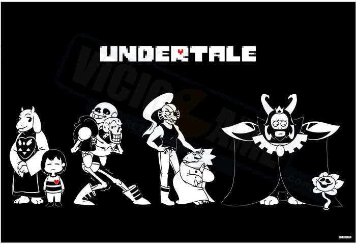

## A Arte de Contar Histórias

Dentre todas as tradições que a humanidade possui, uma das mais antigas é a Contação de Histórias. Desde a Grécia Antiga, quando os Aedos e os Rapsodos se encarregavam de cantar os Poemas Épicos acompanhados da Lira para retratar fatos históricos dos Heróis de Guerra, ensinar sobre as crenças do povo e até ensinamentos importantes sobre o cultivo de alimentos, e hábitos importantes para se conviver naquela sociedade, as histórias e principalmente a maneira como elas são contadas e apresentadas têm uma importância e um prestígio na sociedade. Desde então, a humanidade criou novas formas de contar, compartilhar e eternizar histórias que carregam ensinamentos importantes, ou que marcaram uma geração de pessoas seja pelo seu enredo, personagens ou como ela afetou a sociedade naquela época.

Durante a história, a humanidade criou novas formas de contar histórias, criando verdadeiras experiências com o cinema, novelas, seriados, radionovelas e quadrinhos. Com isso, camadas foram sendo formadas na arte de se criar uma imersão cada vez mais potente. Isso porque para ser imersivo, a consciência do leitor deve se transferir à história que ele está lendo ou assistindo: os cheiros, sons, os sentimentos do consumidor são manipulados pelo que está consumindo.

## As Camadas do Storytelling

Com os livros, nós temos a primeira camada da imersão: o texto. A leitura de uma história muito boa pode ter uma imersão tão potente que desliga o leitor do mundo exterior. Já vi pessoas tão envolvidas com um livro que foi difícil fazê-la largar a história para fazer uma pergunta, ou conversar sobre algo, e era visível que ela não estava nos ignorando; ela estava simplesmente aproveitando ao máximo daquela história. Esse texto também pode vir da maneira auditiva, quando falamos de “audiolivro”, ou pode ser uma dimensão única apenas imagética no caso dos livros de imagem (picture books). Ou seja, quando estamos pensando no unidimensional, essa dimensão pode ser tanto auditiva, quanto imagética quanto textual, mas unicamente de apenas um desses elementos.

Os quadrinhos, por sua vez, são a segunda camada de imersão: imagético-textual. Nessa instância há texto e imagens que se complementam com personagens já imaginados e desenhados, o que em um primeiro momento pode parecer que é uma versão “inferior” ou “mais fácil” de livros, mas que na verdade permite uma nova gama de criações e histórias que talvez não funcionassem apenas com o texto. Certos diálogos e cenários precisam do estímulo visual para serem absorvidos por completo.

Na terceira camada temos o audiovisual: Texto, imagem e som. O texto se transforma no roteiro do filme, série ou novela, a imagem são as filmagens e o som são os efeitos e trilha sonora. A execução neste ponto já é muito mais complexa, já que nesses casos existe uma fantasia ou realidade simulados na tela, e esta precisa ser convincente não só com um bom roteiro, mas também uma boa direção, atuação e a direção de fotografia também não pode ser medíocre, senão toda a obra sofre.

## Storytelling e mídia

Mesmo assim, ver um filme bem executado traz uma catarse completamente diferente, e o impacto definitivamente pode ser sentido. A transmissão da emoção é muito mais palpável e especialmente com o fenômeno das salas de cinema preparadas para absorver o espectador trazida por Edgar Morín em seu artigo O Cinema ou o Homem Imaginário (p. 118, 1970), há um ambiente próprio para que se entre na história e esqueça por um tempo da rotina cotidiana.

Com isso, já conhecemos três camadas de imersão. A primeira do texto depende da imaginação do leitor e de quão bem o escritor consegue emergir isso com sua história; a segunda é imagético-textual e depende tanto de um bom roteiro e bons diálogos, mas também de bons visuais e cenários convincentes; a terceira camada – audiovisual – coloca som e imagem em movimento na fórmula, acrescentando mais elementos que irão isolar o espectador do mundo ao redor e ajudá-lo a entrar na história. Mesmo assim, uma história que tem um diálogo fraco, uma história inverossímil ou uma trilha sonora dissonante da energia da cena facilmente encerram a suspensão de crença e o espectador lembra-se de que aquilo é uma simulação, o tirando de sua imersão.

## Games e Storytelling

A quarta camada do _storytelling_ começa com Zorg em 1970, quando cria uma experiência de livro interativo, em que o jogador escreve comandos simples para explorar uma caverna e encontrar seus tesouros; cria-se então o jogo que age como uma história com o leitor interferindo e agindo como elemento ativo dentro dela: é o início da criatividade como camada de imersão, assim como inaugurado o gênero dos Adventure Games.

Durante anos esse gênero, protagonizado especialmente pela **Sierra Games** e pela **LucasArts**, eram os pioneiros no _storytelling_ mais complexo dos games. King’s Quest, franquia desenvolvida pela Sierra, especialmente se espelhava em um conto de fadas, trazendo personagens conhecidas e um cenário de antigas literaturas fantásticas, trazendo magos, dragões e criaturas mitológicas para ilustrar a jornada de um aventureiro em busca de um tesouro, da mulher amada ou de uma cura milagrosa para salvar um rei.
Roberta Williams, líder da Sierra Games durante seus anos de ouro, diz:

> Basicamente, o que me intrigou é o fato de que, já que eu sou uma contadora de histórias, e eu sempre fui uma contadora de histórias, é o fato de que isso era uma dimensão além de apenas um livro ou um filme, o fato de que você pode interagir com uma história e controlar – ou ter o sentimento de que você está em controle – de uma história. Isso que me intrigou, essa era uma nova dimensão para um enredo. É isso porque eu faço \[adventure games\], é disso que eu tiro o meu prazer.
>
> **Roberta Williams em sua entrevista ao Museu de História Americana em 1987.**

## A quarta camada do Storytelling

Toda a idéia apresentada neste artigo da “quarta camada” vêm desta afirmação por Roberta, que mostra que quando você tira o consumidor do papel de espectador passivo do processo e o coloca como protagonista da história, tomando as suas decisões e vivendo aquilo, sua maneira de encarar e sentir aquela história é completamente diferente, usando as suas próprias referências de vida e personalidade como elementos vivos daquilo. Ou seja, ao invés de ver um herói com história e personalidade definidos, o jogador torna-se e molda a história e personalidade durante seu jogo.
Artur Palma Mungioli (2014) afirma que as narrativas de videogames se diferenciam das de televisão e cinema pelas inúmeras possibilidades de construções não-lineares da história, assim como de personagens, de mundos e de enredo. Com isso, tornam-se um fenômeno completamente ímpar como mídia.

Se pegarmos exemplos concretos, temos Undertale com uma construção de mundo que se molda de acordo com a maneira que o jogador aborda sua experiência; se o jogador matar só um monstro durante toda a aventura, isso será cobrado dele de qualquer forma, se ele matar um chefão específico, ou um monstro em particular, o mundo irá reagir, com alguns personagens não se importando, mas outros percebendo e mudando seu diálogo de acordo com isso. Isso é um exemplo da quarta dimensão de imersão, na qual se tem um cenário fixo que se molda e ajusta de acordo com a forma que o jogador age e reage com o que lhe é apresentado.

---

## Conclusão

Murray (2003) afirma que o espaço do mito no videogame vem da constante aproximação entre fantasia e realidade, criando uma realidade alternativa que propicia ao jogador uma experiência de imersão. Com isso, podemos ver que a suspensão de crença e o envolvimento com o enredo e personagens do jogo são essenciais para que a experiência seja completa e constante durante a interação entre jogador e jogo.

Com isso, o _storytelling_ torna-se coluna vertebral da experiência de jogo, e disso é composto da narrativa, história e personagens. Quando esta deixa de ser engajante, toda a estrutura do videogame cai por terra e o jogador perde o interesse. Assim como um filme com personagens ruins ou história inverossímil, o jogo focado em história e narrativa ruim arranca do jogador a suspensão de crença.

Em conclusão: podemos entender que todas essas camadas de elementos usados para um bom _storytelling_ tem a ver com a imersão do consumidor/espectador e com quão completa e complexa é esta imersão. Quanto mais elementos, maior a imersão, mas também mais difícil esta se torna de se manter constante; é tudo como um enorme relógio que pode funcionar suficientemente bem com uma engrenagem, mas que ganha mais precisão e é mais eficiente com quatro engrenagens. A manutenção de quatro engrenagens é muito mais difícil do que com uma, mas o resultado é muito melhor.
